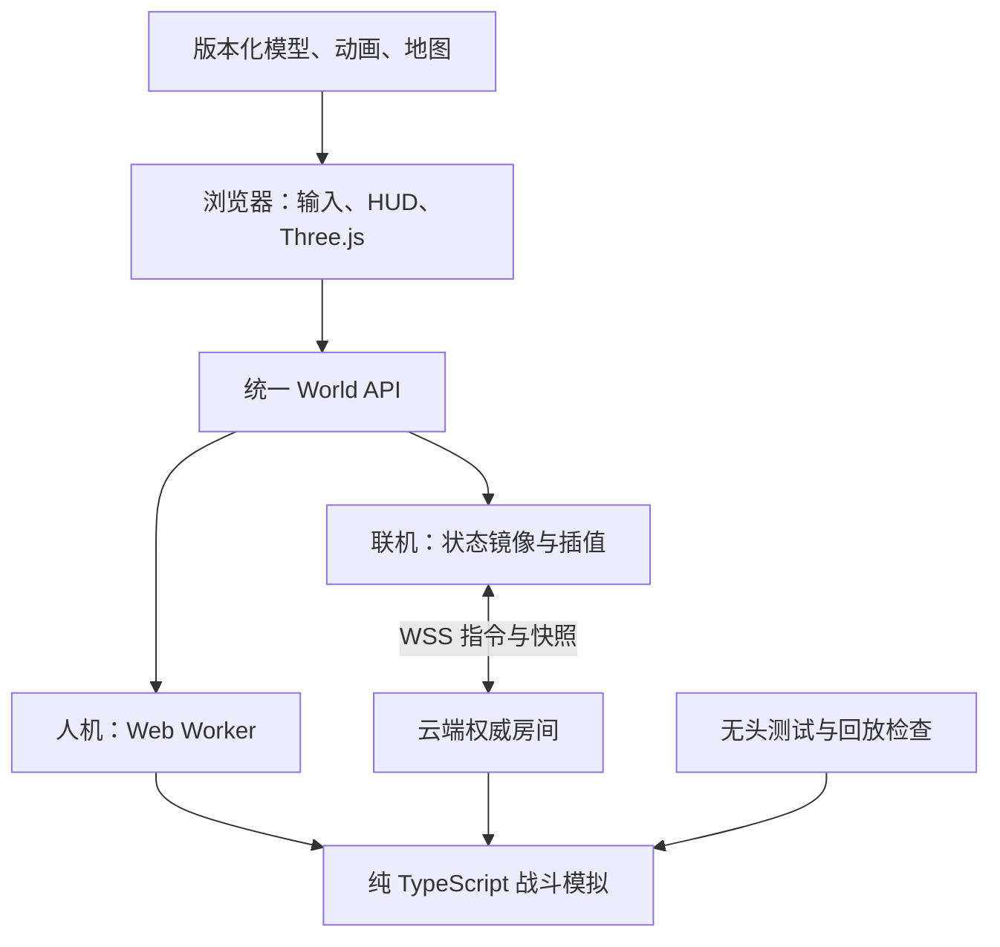

# HOTS 浏览器单线乱斗：整体设计 v0.1

日期：2026-11-06（北京时间）  
状态：**设计提案，等待产品方向确认；没有游戏实现、部署或性能实测。**  
目标仓库：ZJAllenJiang/HOTS。现有 main 只有 LICENSE。本文是唯一技术设计正文；OpenSpec 中的 design.md 引用本文，避免维护两套冲突设计。

## 1. 产品目标与边界

做一个打开网址即可玩的《风暴英雄》单线乱斗体验：固定俯视 3D、5v5、团队经验、天赋、角色分工、技能连招和推线拆核心。优先还原战斗操作、辨识度和团队节奏。初期只做一个地图和少量英雄，但进入正式英雄池的英雄必须具有固定原作版本在该模式下允许的全部基础技能、英雄技能选择和天赋；不由开发者任意裁剪天赋。

用户已明确：浏览器运行；首版单线；清晰素材；其他设计尽量接近原作；参考 Claude of Legends / WoW 浏览器实现；允许考虑 Unity；云端开发和部署。

以下是本提案的建议，尚不是用户已确认的决定：TypeScript + Three.js；先桌面键鼠；6 名英雄；先人机后私人房间联机；首张图按 Lost Cavern 单线路径的玩法特点设计；新加坡部署候选。手机可以浏览主页，触屏战斗不纳入第一版验收。

这是重新实现的浏览器游戏，不是把暴雪客户端直接搬进网页，也不连接 Battle.net。正式素材的来源和可发布范围是独立输入；开源工具的许可证不能替代素材的使用依据。公开部署只纳入具备明确发布依据的素材。临时模型只能用于开发验证，不能用它宣称已达到原作视觉目标。

成功标准：进入游戏 → 选英雄 → 与队友推线/团战 → 升级选天赋 → 摧毁核心 → 查看结算 → 再来一局。整个循环在浏览器完成；联机双方对胜负、伤害、经验和位置有一致结果。

暂不做：全部英雄、多地图机制、排位匹配、商城皮肤、玩家自定义英雄、AI 训练平台、MMORPG 持久世界、语音、原作协议兼容。它们会分散首版工作量。

## 2. 已核实的参考项目与路线

| 路线 | 可借鉴部分 | 代价与结论 |
|---|---|---|
| Claude of Legends | TS 共享模拟、20Hz 固定步进、Three.js、WebSocket、机器人 Policy、无头测试、资产清单 | 最接近本目标。其现有代码还有三线、经济、装备、Forge、训练、其他模式，整仓 fork 后删除和改造的工作不小 |
| World of Claudecraft | 模拟/表现隔离、权威服务器、资源加工和游戏 UI 工程 | 可借鉴架构和素材流程，不继承 MMO 的任务、背包、数据库等系统 |
| Unity Web | 成熟场景/动画/特效工具，可输出 Web 构建，也有云构建服务 | 可行；更适合已有 Unity 工程/美术团队，或明确需要原生客户端。云构建不等于云端可视化编辑器；仍需 Editor 工作流及 Web 平台适配 |
| Babylon.js | 浏览器 3D 引擎，较多现成引擎工具 | 合理备选，但参考项目渲染器不能直接复用。当前没有明确收益足以承担迁移 |

**建议：在 HOTS 建立独立 TS 工程，借鉴 Claude of Legends 架构并选择性迁移基础模块，而不是整仓改皮。**

Claude of Legends 的 ADR 0001 明确说它借鉴 World of Claudecraft 的架构后重新实现 MOBA，并非 fork。这也是本项目的适合做法。源码检查显示 src/sim/sim.ts 已耦合装备、金币、符印、三线目标和其他模式；直接换地图和模型并不能变成 HOTS。

准备复用：经过许可及依赖检查的 RNG、几何辅助、路径搜索思路、快照/插值模式、资产加载与测试模式。逐模块记载上游 commit、原文件、许可和修改；迁移的代码保留相应版权声明及测试。

需要为 HOTS 重做：团队 XP、天赋层、英雄特质、QWE/R 解锁规则、兵线/建筑目标规则、续航、选人、技能事件和 HUD。首期不搬运账号系统、Forge、机器人训练和 MMO 业务。

参考快照（研究时 main 的 HEAD；实现时必须重新固定迁移版本）：
- Claude of Legends：c83fe681bc484f2fa61c5766cb09da8d7b1116d8。
- World of Claudecraft：ef93e018f6196c5d9b8a0052eac6fb17d7b22a93。
- 本次只做源码与文档审查，没有运行这两个项目，未验证其线上容量或视觉质量。

## 3. 分阶段范围：每阶段都能打开链接验收

| 阶段 | 交付 | 退出标准 |
|---|---|---|
| M0 技术/视觉样片 | 1 名英雄、地面、敌方木桩、移动普攻和 1 个代表性技能、资源展示页 | 正常游戏镜头中轮廓/动画/技能可读；素材管线可复现；形成性能记录 |
| M1 单线战斗切片 | 3 名英雄（雷诺、吉安娜、穆拉丁的机制目标），1 人+9 机器人、兵线建筑、基础经验、1 个英雄技能分支 | 能从开局打到结算；明确标记为开发切片，不当作完整 ARAM |
| M2 人机首版 | 6 英雄、固定版本全量合法技能/天赋、随机三选一、团队等级、补给机制、AI 角色分工 | 10 个席位完整打完；正式英雄池无占位技能和不可用天赋 |
| M3 联机首版 | 1–10 真人私人房间、剩余位置填 AI、重连、版本一致性、部署与回滚 | 两个浏览器+远端朋友完成同一场；50/100/150ms RTT 场景经过检查 |

最终“首版”包含 M2 与 M3。M1 是先获得反馈的途径，不用长期替代多人需求。不开全英雄池来填满十人：允许对阵双方重复英雄，机器人按规则补足。

工期只能在 M0 后估算。规则、联网可以持续用 AI 加速，但高质量模型、绑定、动画修正和技能手感仍需要反复检查；不以参考项目的宣传开发时长承诺本项目进度。

## 4. 战斗与地图设计

### 4.1 原作规则与工程参数分开

设置 `contentVersion`、`rulesetVersion` 和 `sourceBuild`。原作规则、英雄数值、地图特例均来自固定数据版本/原作实测；不让 LLM 从记忆补数值，也不假设官网技能简介足够还原执行逻辑。

推荐数据参考 HeroesToolChest/heroes-data2 和 HeroesDataParser。旧 heroes-data 已归档。新仓库含 full/patch 版本，先重建完整基础数据，再应用同版本地图 patch；不能把某次 patch 当全量数据，也不能漏掉 ARAM 地图覆盖。每个数值保留来源、转换规则、是否已实测。没有对应数据的行为明确标 `provisional`；在进入正式英雄池前解决。

数据工具提供数值/文本，不提供一个完整可运行的战斗引擎。技能效果组合、目标合法性、打断、碰撞、伤害时点、天赋互动仍需实现和验证。

### 4.2 首版规则基线

| 项目 | 提案规则 |
|---|---|
| 人数/目标 | 5v5，摧毁敌方核心获胜 |
| 地图 | 单主线，双方防御纵深、侧边绕行/草丛、出生区、补给点；不加入三线野区系统 |
| 经验 | 同队共享 XP 与等级，无补刀金币和装备商店；英雄成长由团队等级驱动 |
| 技能 | Q/W/E + D 特质；R 在英雄技能层开放；是否主动 D 按英雄定义 |
| 天赋 | 常见 1/4/7/10/13/16/20 层；英雄例外由数据定义。10 级支持该英雄在本模式允许的英雄技能选择 |
| 续航 | 启用恢复球/治疗泉；禁用主动回城。出生区不当免费无限回血点；复活恢复状态 |
| 建筑 | 防御塔、堡垒/要塞、核心；攻击优先级、兵线推进、核心护盾/恢复规则逐项锁定版本 |
| 视野 | 草丛、遮挡与队伍视野；服务器不发送队伍看不到的敌人即时位置 |
| 操作 | 右键移动/攻击、A 攻击移动、S 停止、QWER/D、Space 回中；快速施法和范围预览；Z 坐骑按英雄/地图规则处理 |
| 节奏 | 目标一局约 10–20 分钟；这是调优目标，不通过强制提前结束伪造达成 |

首图采取 Lost Cavern 风格的单线结构；精确墙体坐标与建筑/补给布局由 M0–M1 关卡稿记录，未测量前不声称是原图一比一复制。地形表现与导航障碍分别导出，但必须来自同一关卡定义以免“看起来能走，实际被挡”。

M2 随机选人提案：30 秒内每席 3 个不同候选英雄；超时由确定性规则补选；每队至少一个席位包含治疗者候选，候选重排不无限循环。首版小英雄池允许跨席重复选择，明确显示这是小池规则；排除未完整验收英雄。正式原作 ARAM 的完整候选限制另设规则版本，不暗称已完整复刻。M2 的英雄内部技能/天赋则要求全量：先在 M0–M1 建立固定 build 的逐英雄能力清单、地图禁用项和交互验收矩阵。若某英雄无法完成全量清单，应推迟该英雄或协商缩小正式池，不能暗中删掉天赋。

### 4.3 建议首发英雄：先覆盖能力类型

| 机制参照 | 用途 | 必须验证的系统 |
|---|---|---|
| 雷诺 | 远程普攻持续输出 | 攻击前摇、走 A、击退、攻击强化、持续单位/英雄技能 |
| 吉安娜 | 范围法术爆发 | 减速、多段区域伤害、特质增伤、召唤物/区域英雄技能 |
| 穆拉丁 | 坦克切入 | 投射物眩晕、跳跃、阻挡、脱战恢复、击退 |
| 乌瑟尔 | 定向治疗/保护 | 治疗、护甲、无敌/群控、死亡后特质 |
| 维拉 | 灵活物理输出 | 位移、追踪/范围伤害、层数特质、引导技能 |
| 丽丽 | 治疗与反普攻 | 自动选目标治疗、致盲、引导和打断 |

这是建议名单，不是已经完成的英雄。乌瑟尔死亡特质等复杂机制如不能完整实现，该英雄留在实验池；不能删掉关键机制后仍标记完整。阿巴瑟、失落的维京人、古加尔、多形态与多单位微操等放后续。

所有英雄用 `HeroDefinition + AbilityDefinition + TalentDefinition` 结构表达。通用效果先覆盖伤害、治疗、护盾、状态、位移、投射物、区域、召唤、引导与触发器。特殊英雄允许受测试约束的代码模块，不为了“全配置化”发明一个复杂脚本语言。

### 4.4 手感是独立验收项

逐英雄测量移动速度、转向表现、普攻前摇/后摇、攻击间隔、施法前摇、弹速、碰撞半径、范围与恢复时点。命中判定用模拟时钟；动画跟随结果，不用动画回调决定服务器伤害。移动可取消哪些动作、控制如何打断、同一 tick 致死如何处理均写场景测试。

## 5. 素材、清晰度与美术管线

清晰度取决于轮廓、镜头、材质、动画和画面负载，不等于每张贴图都用 4K。优先保障战斗视角下的辨识度；英雄展示页才使用更细 LOD。

流程：来源和发布依据登记 → 保存源模型/贴图/动画 → 云端离线转换 → 材质与骨骼检查 → 动画烘焙 → GLB → meshopt + KTX2 → 资源清单/哈希 → 浏览器资源展示页 → 战斗场景验收。

原作素材路径的候选工具是 SC2Mapster/m3addon（支持 HOTS 使用的 M3 格式）。需要验证具体模型、Blender 版本、骨骼、独立动画、DDS 贴图、粒子和材质节点。该工具的存在不等于全部素材能无损转为 glTF。粒子、拖尾、特殊材质可能需要重建。Three.js 的 GLTFLoader/KTX2Loader 支持加载目标格式，但不替代转换验收。

不默认把原作资产放入公开 Git 仓库。源素材和大文件放受控资产存储，源码提交资源 manifest、内容哈希、工具版本、加工脚本与许可/来源登记。经确认可分发的运行时资产才随发布上传。若没有可用原作素材，使用明确可分发的高质量代用资产进行技术切片，并把“原作外观还原”标为未达标。

| 资源 | 起始预算/规范（待 M0 实测） |
|---|---|
| 英雄模型 | 正常镜头 LOD0 约 15k–35k 三角形，1–3 材质；LOD1 约 6k–12k；不是僵硬上限 |
| 贴图 | 英雄主贴图通常 2K，普通单位/建筑 1K–2K；只在展示近景有收益时给 4K |
| 动画 | idle/run/attack/cast/hit/death；所需坐骑、跳跃、引导单独验证；攻击与位移不能明显滑步 |
| UI | 图标原图通常 256px 起，按实际显示尺寸与 DPR 验收；文字用 DOM/CSS，不烘进低清图片 |
| 光照 | 风格化材质、稳定主光、烘焙环境层；重要单位实时阴影；避免全屏强 bloom 盖住战斗 |
| 特效 | 敌我颜色 + 形状/边缘区别，命中/预警范围对齐实际碰撞；减少透明 overdraw |
| 分辨率 | 默认桌面 1080p，支持 1440p；DPR 上限先 1.5，用户可调整；先降阴影/粒子再降分辨率 |

M0 必须提供：正常镜头/近景各一组、移动/攻击/施法/死亡短视频、10 单位混战截图、资源体积、CPU/GPU 帧时间。占位几何体仅用于碰撞调试。

资源加载按菜单/选人/该局地图和英雄分包。首局先确保所有必需资源 ready 再发 start，低速客户端显示进度与重试；不要求下载全英雄库。重连时可用缓存，但版本和 hash 必须一致。

## 6. 技术架构

建议栈：TypeScript strict、Three.js（WebGL2 为基线）、Vite、Node.js LTS、pnpm、WebSocket、Vitest、Playwright、Docker。实施阶段固定当时受支持版本和 lockfile，不引用“latest”作为生产依赖。WebGPU 可作为后续优化，不作为进入游戏门槛。

浏览器实际渲染游戏；服务器计算联机规则，不传视频、不需要云游戏 GPU。Three.js 仅负责表现，模拟模块不得导入 DOM、Three.js、真实时间或非受控随机函数。

### 6.1 建议代码布局（待实施创建）

| 路径 | 职责 |
|---|---|
| apps/web | 输入、镜头、Three.js、音频、DOM HUD、加载与网络状态 |
| apps/server | HTTP/WSS、临时会话、房间、定时器、连接验证、指标 |
| packages/sim | 固定步进、移动/导航、战斗、视野、经验、天赋、AI |
| packages/protocol | 消息 schema、协议版本、合法输入和快照 |
| packages/content | 英雄/地图/规则版本、参数与来源追溯 |
| tools/assets | 转换、压缩、清单检查、生成资源展示场景 |
| tests | 模拟场景、跨宿主一致性、多客户端与浏览器验收 |

### 6.2 模拟、时间与确定性

起始逻辑频率 20Hz（50ms/tick），渲染独立目标 60fps。20Hz 是工程起点，不是原作 tick 声明；M0 测试高速弹道、走 A 和位移，必要时评估 30Hz。快速物体使用 swept segment 检测，避免一帧跨过目标。

种子 RNG；稳定实体排序；固定系统执行顺序；序列化整数 tick/ID；禁止模拟内 Date.now/Math.random。跨浏览器浮点结果并非因“都是 TS”就自然一致：限制敏感数学运算，参数预计算，固定求值顺序；Node/Chromium/Firefox/WebKit 使用同 seed 与指令流比较逐 tick 状态 hash。同一固定 Node 运行时的逐 tick 一致性是游戏发布门槛。跨浏览器逐 tick 一致性是“精确重模拟回放”的发布门槛，不阻塞服务器权威对战或人机玩法；如果跨引擎检查未通过，只提供服务器快照/事件回放并明确禁用精确重模拟。实时联机不依赖浏览器重算战斗结果。

默认 tick 顺序：接收合法指令 → 状态到期 → 冷却/恢复 → AI 决策 → 移动/寻路 → 施法/普攻 → 弹道/区域效果 → 死亡/经验/复活 → 视野 → 胜负 → 快照。结算伤害批次对同 tick 双方致死有固定规则，并写对称性测试。纯函数核心便于更改顺序并比较回放。

导航采用二维平面障碍网格 + A* + 路径平滑，单位圆形碰撞和有限分离；固定俯视 3D 美术不要求完整 3D 物理引擎。地图的跳跃、击退越墙行为用显式能力规则，不能直接让渲染位移穿越碰撞。

### 6.3 联机房间

从 M1 起保持同一 command/snapshot 接口，人机走 LocalWorld，联机走 RemoteWorld；M3 只替换宿主，不重写英雄。

- 房间状态：lobby → selecting → loading → playing → result → closed。房主断开后迁移控制权；比赛结果由服务器决定。
- MVP 私人房间，6 位分享码，仅用于找到房间；席位身份使用独立随机会话令牌。一个席位任一时刻只有一个控制连接。
- 客户端消息包含 protocolVersion、matchId、commandSeq、输入；目标 tick 只是提示，不能让客户端指定伤害或任意倒退服务器时间。
- 服务器检查身份、频率、大小、坐标、目标可见性、冷却、资源、死亡/控制状态；只接受合法指令；重复 seq 不重复施法。
- 基线输入上限 30 条/秒/席位，包大小上限 8KiB；超限降速或拒绝，不把用户提交字段直接绑定其他玩家身份。
- 模拟 20Hz；快照先 10Hz，局部移动立即视觉响应，远端状态约 100ms 插值。仅对本玩家移动做有限预测与校正；命中/伤害/控制由服务器确认。
- 全量初始快照 + 后续增量；带 serverTick、snapshotId、ackSeq、contentVersion。关键事件单独编号；缺 baseline 请求全量，重复事件去重。
- 断线 5 秒后 AI 接管；保留席位 60 秒。重连校验令牌并发全量快照；成功后原控制权作废。超过 60 秒本局该席保持 AI；房间仍有真人则继续。
- loading 最多等待 60 秒；未 ready 的真人断开并由 AI 补位，告知该玩家可在席位保留窗口内重连。版本不符拒绝进入并提供刷新指引。
- 第一期不承诺服务器进程崩溃后恢复正在进行的比赛：客户端明确显示对局中断、允许返回房间/重开；不得伪造胜负。正常发布采用排空流程。

机器人使用同一指令接口与队伍可见观察。选用规则/效用评分，覆盖集火、治疗、撤退、躲避明显范围技能、保护兵线与塔下风险；不把 LLM API 调用放进实时战斗循环。

### 6.4 数据与扩容

私人测试无强制注册；玩家设昵称取得短期匿名会话。首版房间状态在内存，结算/诊断记录可写持久卷 SQLite；无持久卷时必须明确只提供临时对局，不假装保存战绩。后续开放账号/跨实例统计再迁移 PostgreSQL。

先单个常驻 Node 服务，单实例接纳数量设为经压测确定的上限。多实例不能只增加副本：需房间目录、join 路由、实例归属、重连定位及排空迁移设计；暂不引入 Redis/Kubernetes。

## 7. 云端开发、构建和部署

**全程不要求用户本机安装 Node、Unity 或 Blender。**

开发候选：GitHub Codespaces 的浏览器 IDE + devcontainer（Node/pnpm/测试浏览器）；也可让云端编码环境从同一 GitHub 分支工作。Codespaces 有实际 VM/终端，github.dev 仅编辑器不能替代运行环境。资源加工使用独立云端批处理容器；需要人工调骨骼/材质时使用远程桌面美术工作站，而不是承诺所有转换都自动成功。

交付建议：
1. M0/M1 的离线人机版可用静态托管；作为快速可访问预览。
2. M3 用常驻 Node Docker 服务同时提供前端静态文件和 `/ws`，先保持同域，减少配置点；资源量增大后把版本化大资产分到 CDN/对象存储。
3. 托管候选 Render Web Service（支持 WSS，区域候选 Singapore）；也可迁往同等支持长连接的容器主机。最终地域以实际玩家所在地的 RTT 测试决定，不能凭 CDN 节点推断战斗延迟。
4. 静态 Pages/CDN 只托管前端，不能充当常驻权威房间。普通请求型函数也不能默认承接持续 20Hz 游戏循环；如采用特殊有状态边缘运行时，另做能力验证。
5. PR 运行类型/模拟/资源/构建检查并产生预览；发布标签绑定源码 SHA、contentVersion、assetManifestHash 和不可变容器 digest。
6. 健康检查分 liveness 与 readiness；readiness 失败停止接新房间。正常发布先停建房、等待在局结束，最迟 30 分钟后提前通知并结束旧实例；MVP 不承诺活跃对局热迁移。
7. 回滚同时恢复客户端、服务器、协议和内容清单。旧版本资产至少保留两个发布版本；正在进行的旧版本房间不混入新规则。

平台自动替换实例会断开 WebSocket；首版关闭无条件“每次 push 自动替换生产”，使用手动/流水线受控发布和应用排空。预览环境可随 PR 更新。

目前没有创建 Codespace、购买算力、接入云账号、上传原作素材或部署游戏；本轮仅交付设计。需要付费账号/授权时，在有可部署产物后再处理具体平台连接。

## 8. 性能与质量验收

以下均为目标预算，不是已取得的测量数据。M0 固定实际机器、浏览器版本、网络和场景，保存测试报告。

| 项目 | 初始目标 |
|---|---|
| 浏览器基线 | 最近两个稳定版桌面 Chrome/Edge/Firefox/Safari，WebGL2；不支持时清楚提示 |
| 参考客户端 | Apple M1 / 8GB / 1080p，中档画质；同时抽测 Intel Iris Xe Windows 浏览器 |
| 场景 | 10 英雄 + 80 小兵 + 30 在场弹道/技能区域，连续战斗 5 分钟 |
| 帧率 | M1 基准中位数 ≥60fps、p95 帧时间 ≤25ms；低配档目标 ≥30fps |
| 服务器 | 起始压测 2vCPU/4GB，单房 sim tick p95 <10ms；逐步加房确定容量，不承诺预设房间数 |
| 下载 | 首局必需压缩资源目标 ≤30MiB；选人后预加载；后续局复用缓存 |
| 网络 | 100ms RTT 下可完整操作；50/100/150ms、短暂掉线/抖动分别测；WebSocket 丢包后的队头阻塞也计入 |
| 状态传输 | 目标每客户端平均下行 ≤30KiB/s，实测包括协议开销与峰值；不凭消息条数估算成本 |
| 资源健康 | 连续重开 10 局，内存无持续增长；处理 WebGL context lost 和资源失败重试 |

FPS 超标时依次减少阴影距离/频率、粒子、远景细节，再调动态分辨率；文字/选中圈/技能边缘保持清楚。不要用自动糊屏隐藏性能问题。费用按实测并发、活跃时长、传输和资产体积估算，另列云开发与美术制作；不把免费休眠实例当可靠联机服务器。

## 9. SDD：OpenSpec 与 Superpowers 的职责

OpenSpec 管需求与变化：proposal → capability specs → design → tasks → 验证/归档。Superpowers 的设计审阅和后续小步实现、测试、代码审查用于执行。两个系统共用一份设计，不重复维护“另一份需求”。

本次落地：`openspec/changes/browser-aram-foundation/` 下 proposal、设计索引、5 个 capability specs、里程碑任务；正文位于本文件。所有任务未勾选；没有把写文档标成游戏已完成。正式 baseline specs 在实现验收/归档时建立，不把提案提前当成已交付能力。

详细函数级实现计划在方向确认和 M0 研究完成后再生成；当前任务是里程碑与验收依赖，不是假装已确定所有英雄参数。OpenSpec CLI 和 Superpowers 插件尚未安装；本包按上游文档格式编写，不声称已执行它们的 CLI 或测试。

每个迭代交付：变更说明、对应场景、必要测试结果、预览链接或视频、素材清单变化、已知差异。战斗规则使用小步测试驱动；美术不以单元测试替代实际画面与操作验收。

## 10. 风险与下一步决策

| 风险 | 应对 |
|---|---|
| 能跑但外观不像 | M0 先审一个完整英雄；没有通过则修美术管线，不盲目扩英雄 |
| 数据存在但技能无法正确运行 | 数据导入与执行逻辑分离；用具体英雄逐项验收，记录差异 |
| 模型转换丢动画/粒子 | 固定工具版本，三种代表资源做 spike；必要时重做动画/特效 |
| 整仓 fork 改造失控 | 独立核心、有限模块迁移、每项来源和契约明确 |
| 联机晚加导致重写 | 从首个切片使用统一指令/快照接口、无头模拟 |
| 云端地域/平台不适合 | 实际网络与负载验证后定部署，不把免费套餐当容量承诺 |

建议先确认主路线是否采用浏览器原生 TS + Three.js。若改为 Unity，OpenSpec 的玩法/视觉需求仍保留，但模拟共享、网络和资产工作流需重写。第一项执行工作应为 M0 的素材与手感样片，不是先铺设所有页面和英雄。

## 11. 核查来源

以下均为 2026-11-06 查阅的项目/厂商资料；工程预算、路线选择和阶段划分是本设计的判断。

- Claude of Legends：[README](https://github.com/killian01/claude-of-legends)、[架构 ADR](https://github.com/killian01/claude-of-legends/blob/main/docs/adr/0001-adopt-world-of-claudecraft-architecture.md)、[跨引擎算术](https://github.com/killian01/claude-of-legends/blob/main/docs/adr/0019-the-sim-rounds-alike-on-every-engine.md)、[素材清单](https://github.com/killian01/claude-of-legends/blob/main/CREDITS.md)。源码抽查 src/sim/sim.ts、src/net/protocol.ts。
- [World of Claudecraft](https://github.com/levy-street/world-of-claudecraft)：共享模拟、权威服与表现接口。
- [OpenSpec](https://github.com/Fission-AI/OpenSpec)、[spec-driven schema](https://github.com/Fission-AI/OpenSpec/blob/main/schemas/spec-driven/schema.yaml)。
- [Superpowers](https://github.com/obra/superpowers)、[brainstorming](https://github.com/obra/superpowers/blob/main/skills/brainstorming/SKILL.md)。
- [Heroes 官方模式介绍](https://heroesofthestorm.blizzard.com/en-us/game/)：ARAM 单线、三选一；不把该简介当完整规则来源。
- [HeroesDataParser](https://github.com/HeroesToolChest/HeroesDataParser)、[heroes-data2](https://github.com/HeroesToolChest/heroes-data2)、[m3addon](https://github.com/SC2Mapster/m3addon)。
- [Three.js GLTFLoader](https://threejs.org/docs/pages/GLTFLoader.html)、[KTX2Loader](https://threejs.org/docs/pages/KTX2Loader.html)。
- [Unity Web 限制](https://docs.unity.com/en-us/engine/6000.7/manual/platform-specific/webgl/intro/technical-overview)、[Unity 云构建](https://docs.unity.com/en-us/build-automation)。
- [GitHub 云开发容器](https://docs.github.com/en/codespaces/setting-up-your-project-for-codespaces/adding-a-dev-container-configuration/introduction-to-dev-containers)。
- [Render WebSocket](https://render.com/docs/websocket)、[区域](https://render.com/docs/regions)、[部署](https://render.com/docs/deploys)。
